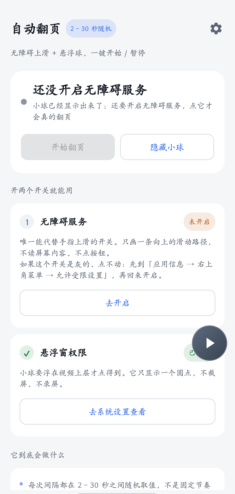

# 自动翻页

[](https://github.com/neurotracee/auto-swipe/blob/main/LICENSE)
[](https://github.com/neurotracee/auto-swipe/releases/latest)
[](https://github.com/neurotracee/auto-swipe/releases)
[](https://github.com/neurotracee/auto-swipe/releases)
[](https://gitee.com/bio234/auto-swipe)

**中文** | [English](#autoswipe)

只做一件事的安卓小工具：用无障碍服务按 **2–30 秒的随机间隔**，替你从下往上滑一次；
配一个可拖动的悬浮球，点一下开始、再点一下立刻停。

不用脚本、不用 root、不装框架，两个系统开关（无障碍、悬浮窗）打开就能用。全程本地运行，
不读取屏幕内容、不模拟点击、不上传任何东西。



> 截图就是实际界面：顶部一行实时状态（在不在翻、翻了几页、下次还有几秒），下面两步把权限开齐，
> 再往下写清楚它到底会做什么。右边那个深灰圆形、白色 ▶ 就是悬浮球——**暂停态是 ▶，运行态变成 ⏸**。

---

## 这个项目是谁做的

- **指导作者：项目创作时为初中生。** 需求、交互设计、验收测试全部由本人完成。
- **开发：豆包工作任务 × DeepSeek-V4.1-Flash。** 在指导作者的指令与反复验收下实现代码。
- **模型说明**：主用 **DeepSeek-V4.1-Flash**（核心骨架与全部代码）；这是本人常用的模型，
  不是临时换一个来凑数。
- **开源协议：GNU AGPL-3.0-or-later。** 详见 [LICENSE](LICENSE)，另附
  [ADDITIONAL-TERMS.md](ADDITIONAL-TERMS.md)。
- **来源说明**：检查更新模块（双通道、四段版本号、发布正文解析、应用内下载安装）改编自
  本人另一个项目 [PDF 隐私打码工具](https://github.com/neurotracee/pdf-privacy-masker)，
  同一作者、同一套 AGPL 授权，不是抄来的第三方代码。
- **维护方式**：个人业余时间维护，代码全部公开，欢迎任何人 fork 自行改进，不必询问。
  具体节奏与反馈渠道见文末「[维护节奏与反馈](#维护节奏与反馈)」。

## 关于署名（二次开发或商用前请先看这一段）

本项目**允许商用，也允许二次开发**，不需要付钱、不需要申请、不需要等作者批准
（作者大约一两个月查看一次项目，回复可能很慢）。

但下面**三条是硬要求**，属于 [ADDITIONAL-TERMS.md](ADDITIONAL-TERMS.md) 中
依据 AGPL-3.0 第 7 条 (b) 项声明的附加条款，删掉任何一条都不合规：

### ① 保留作者署名

继续注明这两句，原文保留，不要替换成别人的名字：

```
指导作者：项目创作时为初中生
由 豆包工作任务 × DeepSeek-V4.1-Flash 开发
```

依据 AGPL-3.0 第 5 条（保留版权声明）；第 7 条 (b) 项明确允许版权方要求保留作者署名。

### ② 在程序里标注原项目地址

```
https://github.com/neurotracee/auto-swipe
https://gitee.com/bio234/auto-swipe      # mirror / 镜像（国内访问更快）
```

**必须让使用者看得见**——「设置 → 关于」、首页页脚，任选一处即可。
只写在 `LICENSE` 文件或源码注释里**不算数**，因为使用者正常操作时看不到。

本项目的做法（可以直接照搬）：首页页脚一行 `v1.0.0.x · 开源仓库`（点一下打开仓库）；
「设置 → 关于」里写明版本、用途与仓库地址。

### ③ 改过的版本必须说明改过

只要你不是拿原版原样分发，就在程序里显著注明：

> 本程序基于 https://github.com/neurotracee/auto-swipe
> （镜像：https://gitee.com/bio234/auto-swipe）修改，非原作者发布。

这一条是为了不让人误以为改动后的版本出自原作者——尤其是你的版本有 bug、
有风险、或者开始收费的时候。

### 除此之外，AGPL-3.0 本身还要求

- **一并开放源代码**：分发 apk 时提供可构建出该 apk 的完整源码（第 4–6 条）。
- **网络服务也要给源码**：把修改版做成网站让别人用，必须向这些使用者提供源码获取方式（第 13 条）。
- **不要加更严的限制**：不能改成「禁止商用」「禁止修改」，那与 AGPL-3.0 冲突，写了也不生效。
- **换个名字**：程序名「自动翻页」与图标不在授权范围内（第 7 条 (e) 项），fork 请改名换图标。

---

## 权限：只要三个，每个都能随时收回

| 权限 | 用来做什么 | 明确不做 |
| --- | --- | --- |
| **无障碍服务** `BIND_ACCESSIBILITY_SERVICE` | 用系统给的 `dispatchGesture` 画一条从下往上的滑动路径 | 不读屏幕内容、不读输入框、不模拟点击按钮、不联网 |
| **悬浮窗** `SYSTEM_ALERT_WINDOW` | 把小球画在视频/短视频 App 的上面 | 不截屏、不录屏、不读别的应用界面 |
| **网络** `INTERNET` ＋ **安装应用** `REQUEST_INSTALL_PACKAGES` | 只在你点「检查更新」时读公开版本号、你确认后下载新版安装包 | 平时完全不联网，不上传任何内容 |

没有存储、定位、相机、麦克风、通讯录、读取已安装应用列表等权限。

## 它是怎么滑的

- **间隔**：第一次在点开始后固定等 1.5 秒（留出切回视频 App 的时间），之后每两次之间
  取 `Random.nextLong(2000, 30001)`，即 **2–30 秒随机**，含两端、毫秒级，不固定节奏。
- **起止漂移**：每次起点在横向 40%–60%、纵向 73.5%–80% 里随机，终点在 27.5%–34.5% 里随机，
  起止横向差最多 5% 屏宽。漂移有上限，不会落到侧边栏、导航条或屏幕边缘——
  **有变化，但每一次都还是一次有效上滑**。
- **轨迹形状**：带 0.6%–1.6% 屏宽的 S 形弯曲，另加 0.2%–0.7% 屏宽的细波动，
  弯曲方向、强弱每拍都不同；纵向严格单调向上，不会滑到一半折回来。
- **真实变速**：整条轨迹按「起步 30% 距离 / 42% 时间、主体 50% / 36%、收尾 20% / 22%」
  切三段，用 `willContinue` 连续笔画串起来，手指全程不抬起——先慢、中间快、末尾缓的
  一整次滑动，不是三次独立滑动。单次总时长 0.38–0.64 秒随机。
- **手势来源**：`AccessibilityService.dispatchGesture`，标准无障碍手势，不注入触摸事件、不做自动化点击。
- **悬浮球**：由独立的 `BallService` 托管，**只依赖悬浮窗权限**，不要求无障碍先连上。
  暂停态显示白色右三角 ▶，运行态是两道竖杠 ⏸；可拖动、位置会记住。
  点球时如果无障碍还没开，会明确提示「还差一步」并跳到无障碍设置。
- **停下来的方式**：再点一次小球 / 应用内暂停 / 息屏自动暂停 / 系统里关掉无障碍开关（循环与小球一起收干净）。
- **状态显示**：首页实时显示「已翻 N 页 · 下次约 X 秒 · 上次间隔 Y 秒」，
  上一次的间隔是真实取值，不是显示 2–30 的字样糊弄人。
- **兼容边界**：部分应用对无障碍手势有限制（尤其带安全键盘、支付页面、部分游戏和部分短视频极速版），
  滑不动是目标应用的限制，不是本应用故障。遇到这类界面建议直接手动。

## 隐私

没有后台联网，没有统计 SDK，没有崩溃上报，没有云端模型。

- 手势只在设备本地执行，滑动轨迹不记录、不上传。
- 设置（主题、球的位置、更新源）只存在本机 `SharedPreferences` 里。
- 唯一的联网行为：你点「检查更新」（或开启启动时自动检查）时，向 Gitee / GitHub 读一次
  公开的发布列表；点「立即更新」后，才从这两个官方域名下载安装包。
- 断网时检查更新直接跳过，不弹窗、不卡住、不影响翻页。

## 检查更新（与本人 PDF 项目同一套机制）

- **双通道**：Gitee / GitHub。默认「跟随环境」——中文系统优先 Gitee，非中文但在东八区也走 Gitee，
  只有「语言不是中文 + 时区不在东八区」才用 GitHub；判断不出来一律 Gitee。选中的源连不上会自动换另一个，
  并在界面上写明「Gitee 这次没连上，已自动改用 GitHub」，不让人猜。
- **更新级别**：发布正文行首写 `更新级别：强烈建议` 或 `更新级别：建议`（不写按建议）。
  两档都只是建议，**永远留关闭按钮**，关之前最多挽留一次；没有任何「不更新就不给用」的路径。
- **应用内安装**：点「立即更新」后由应用自己下载并核对（头 2 字节是 `PK`、大小一致、
  包名是本应用、版本号等于要装的那一版），再交给系统安装器。不走浏览器，
  避开 Gitee 把 `.apk` 存成 `.apk.zip` 的老问题。
- **弹窗内容**：从发布正文里读「一句话」摘要和分平台条目；写什么就显示什么，不在程序里写死。

### 发布正文怎么写（决定更新弹窗长什么样）

```markdown
更新级别：建议

> **一句话**：悬浮球不再要求先开无障碍，隐藏球时循环一起停。

## 1. 修复：给了悬浮窗权限却看不到小球（安卓）

悬浮球改由独立服务托管，只依赖悬浮窗权限。

## 2. 修复：隐藏小球后循环还在跑（安卓）

球消失时把正在跑的循环一并停掉。
```

## 安装

1. 从 [Releases](https://github.com/neurotracee/auto-swipe/releases) 下载 `AutoSwipe-<版本号>.apk`。
2. 系统会提示「未知来源」，允许后安装；**装新版本直接覆盖，不用先卸载**。
3. 打开应用，按首页两步走：
   - **无障碍**：设置 → 无障碍 → 已安装的服务 → 自动翻页 → 开启。
     Android 13 及以上，侧载应用的开关默认是灰的：先到
     「应用信息 → 右上角菜单 → 允许受限设置」，再回来开启。
   - **悬浮窗**：设置 → 应用 → 特殊权限 → 悬浮窗 → 自动翻页 → 允许。
4. 回应用点「显示小球」→ 球出现 → 点球上的 ▶ 开始 → 图标变 ⏸，再点一下停。

## 构建

需要 **JDK 17 + Android SDK 34 + Gradle 8.x**（AGP 8.4.2）。本机实测用的路径写在
[docs/发布指南.md](docs/发布指南.md)。

```bash
./gradlew assembleRelease     # 产物：app/build/outputs/apk/release/app-release.apk
```

Windows 上直接用 `gradlew.bat assembleRelease`（或双击同目录的 `打包.bat`）。仓库自带
Gradle Wrapper，不需要先装 Gradle，第一次运行会自行下载 8.7 发行包。
（**不在仓库里**，自己打包时自建一份；没签名的产物装不上，但签你自己那份就能日常调试）。

版本号四段：`主.次.修订.补丁`，`versionCode` 由 `versionName` 自动算出，不要手填：
`主*1000000 + 次*10000 + 修订*100 + 补丁`（`1.0.0.1` → `1000001`）。

## 目录

```
app/src/main/java/com/neurotracee/autoswipe/
├── App.kt                        Application：初始化偏好
├── AppPrefs.kt                  本地设置（主题、悬浮球位置、更新源）
├── AppState.kt                  服务 → 界面的状态栏
├── MainActivity.kt              首页 + 两个权限入口 + 设置
├── SwipeAccessibilityService.kt 无障碍：随机间隔 + 上滑手势 + 息屏暂停
├── BallService.kt               悬浮球宿主（独立于无障碍）
├── BallController.kt            悬浮窗挂载 / 拖动 / 点击判定
├── BallView.kt                  小球绘制（▶ / ⏸）
├── Updater.kt                   Gitee / GitHub 双通道检查更新
├── UpdateApk.kt                 应用内下载 + 校验 + 交给系统安装器
├── ReleaseDigest.kt             发布正文 → 更新弹窗文案
└── ui/                          主题、首页、设置、更新弹窗（Compose）
```

文档地图：功能看本文件，改了什么看 [CHANGELOG.md](CHANGELOG.md)，怎么参与看
[CONTRIBUTING.md](CONTRIBUTING.md)，第三方与许可看 [NOTICE.md](NOTICE.md)，发版流程看
[docs/发布指南.md](docs/发布指南.md)。

## 常见问题

**Q：小球点了没反应？**
A：先看首页状态。无障碍没开时点球会跳到无障碍设置，这是预期行为；开了无障碍后，点 ▶ 会变成 ⏸。

**Q：开关是灰的，点不动？**
A：Android 13+ 的侧载保护。到「应用信息 → 右上角菜单 → 允许受限设置」，再回来开启。

**Q：滑不动 / 只翻了一页就停？**
A：目标应用限制了无障碍手势，或它的列表不在一个可滚动容器里。这不是本应用能绕过的。
另外确认间隔没有被你手动改小——本应用固定 2–30 秒随机。

**Q：会不会偷偷联网、上传我看了什么？**
A：不会。没有统计 SDK；联网只有检查更新这一个入口，且只发一个读版本号的请求。

**Q：iOS / 电脑上能用吗？**
A：不能。这两种系统的无障碍/辅助功能接口不对第三方开放手势模拟，本项目只做安卓。

## 维护节奏与反馈

- **反馈**：[GitHub Issues](https://github.com/neurotracee/auto-swipe/issues)、
  [Gitee Issues](https://gitee.com/bio234/auto-swipe/issues)。两者都会看，Gitee 更快。
- **节奏**：个人业余时间维护，大约一两个月看一两次；能修的问题会修，不保证时间。
- **Pull Request**：欢迎，但请一个 PR 只做一件事，并在描述里写清楚「改了什么、怎么验证的」。

---

## AutoSwipe

An Android utility that does exactly one thing: it performs a swipe-up gesture every
**2–30 seconds at random**, using the Accessibility Service, so you don't have to keep
swiping yourself. A draggable floating ball starts and stops it with a single tap.

It does **not** read the screen, does **not** simulate taps on buttons, and does **not**
upload anything. The only network access is the optional update check, which reads a
public release list on Gitee / GitHub.

- **License**: GNU AGPL-3.0-or-later, with additional terms under Section 7(b):
  keep the author attribution, display the original project URL in the app,
  and mark modified builds as modified. See [ADDITIONAL-TERMS.md](ADDITIONAL-TERMS.md).
- **Credits**: Advisor — was a junior high school student when this project was created;
  Developed by **Doubao Work × DeepSeek-V4.1-Flash**.
- **Original repository**: https://github.com/neurotracee/auto-swipe
  (mirror: https://gitee.com/bio234/auto-swipe)
- **Build**: JDK 17 + Android SDK 34 + Gradle; `gradle assembleRelease`.
