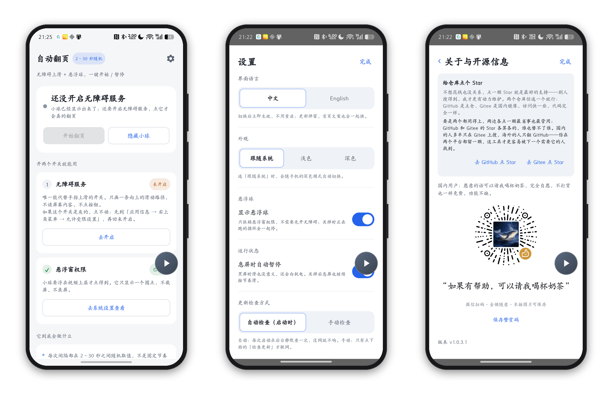
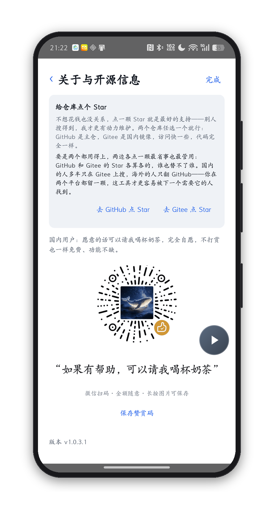
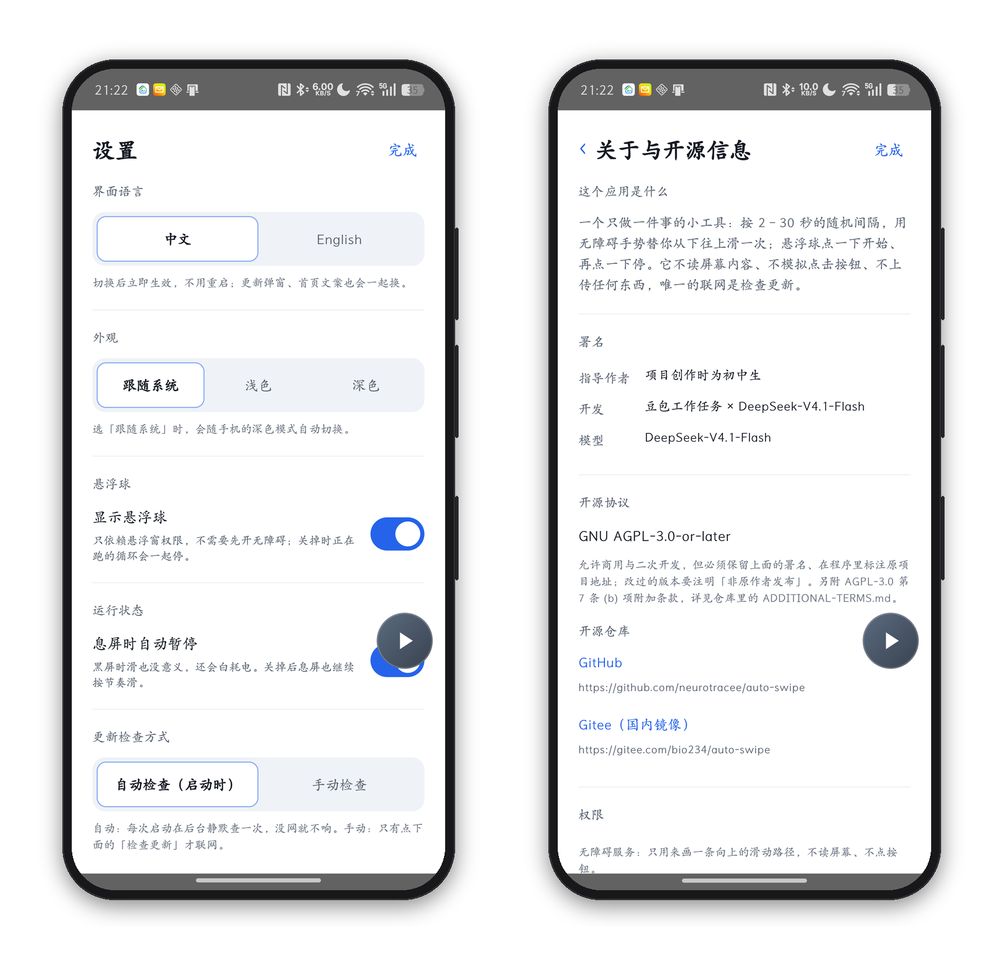
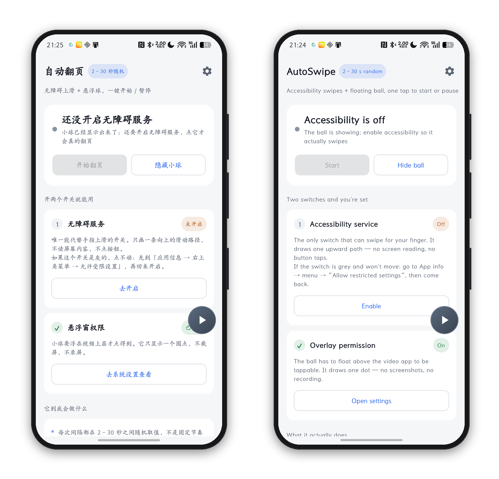
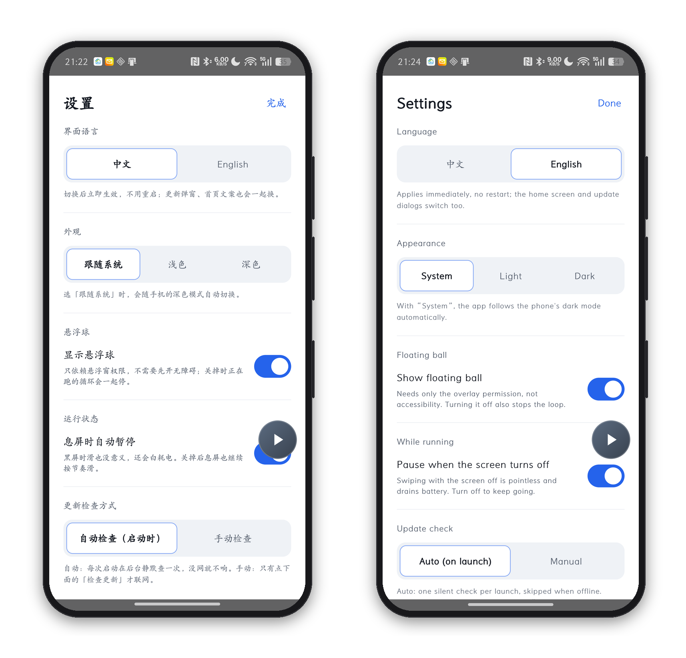

# 自动翻页

[](https://github.com/neurotracee/auto-swipe/blob/main/LICENSE)
[](https://github.com/neurotracee/auto-swipe/releases/latest)
[](https://github.com/neurotracee/auto-swipe/releases)
[](https://github.com/neurotracee/auto-swipe/releases)
[](https://gitee.com/bio234/auto-swipe)

**中文** | [English](#english)

只做一件事的安卓小工具：用无障碍服务按 **2–30 秒的随机间隔**，替你从下往上滑一次；
配一个可拖动的悬浮球，点一下开始、再点一下立刻停。

不用脚本、不用 root、不装框架，两个系统开关（无障碍、悬浮窗）打开就能用。全程本地运行，
不读取屏幕内容、不模拟点击、不上传任何东西。

## 界面

真机截图，不是画稿。外壳是为了好看套上去的，屏幕里的东西一个字没改。

<br>
<h3 align="center">一屏就能看明白</h3>
<p align="center">顶部是实时状态（在不在翻、翻了几页、下次还有几秒），中间两步把权限开齐，下面写清它到底会做什么。</p>
<p align="center">
  
</p>
<br>
<h3 align="center">两个平台，都点得到</h3>
<p align="center">关于页里 GitHub 和 Gitee 各一枚 Star 按钮，旁边是赞赏码；不花钱也能支持，点一颗 Star 就够。</p>
<p align="center">
  
</p>
<br>
<h3 align="center">设置分两级，每一项都真生效</h3>
<p align="center">一级管语言、外观、悬浮球、息屏暂停、更新检查方式与更新源；最下面一行进二级，放署名、协议、来源说明、Star 和赞赏码。</p>
<p align="center">
  
</p>
<br>
<h3 align="center">中文，也说 English</h3>
<p align="center">右上角齿轮里切换，首页、设置、关于、更新弹窗和 Toast 一起换，不用重启。</p>
<p align="center">
  
</p>
<p align="center">
  
</p>

---

## 这个项目是谁做的

- **指导作者：项目创作时为初中生。** 需求、交互设计、验收测试全部由本人完成。
- **开发：豆包工作任务 × DeepSeek-V4.1-Flash。** 在指导作者的指令与反复验收下实现代码。
- **模型说明**：主用 **DeepSeek-V4.1-Flash**（核心骨架与全部代码）；这是本人常用的模型，
  不是临时换一个来凑数。
- **开源协议：GNU AGPL-3.0-or-later。** 详见 [LICENSE](LICENSE)，另附
  [ADDITIONAL-TERMS.md](ADDITIONAL-TERMS.md)。
- **来源说明**：检查更新模块（双通道、四段版本号、发布正文解析、应用内下载安装）改编自
  本人另一个项目 [PDF 隐私打码工具](https://github.com/neurotracee/pdf-privacy-masker)，
  同一作者、同一套 AGPL 授权，不是抄来的第三方代码。
- **维护方式**：个人业余时间维护，代码全部公开，欢迎任何人 fork 自行改进，不必询问。
  具体节奏与反馈渠道见文末「[维护节奏与反馈](#维护节奏与反馈)」。

## 关于署名（二次开发或商用前请先看这一段）

本项目**允许商用，也允许二次开发**，不需要付钱、不需要申请、不需要等作者批准
（作者大约一两个月查看一次项目，回复可能很慢）。

但下面**三条是硬要求**，属于 [ADDITIONAL-TERMS.md](ADDITIONAL-TERMS.md) 中
依据 AGPL-3.0 第 7 条 (b) 项声明的附加条款，删掉任何一条都不合规：

### ① 保留作者署名

继续注明这两句，原文保留，不要替换成别人的名字：

```
指导作者：项目创作时为初中生
由 豆包工作任务 × DeepSeek-V4.1-Flash 开发
```

依据 AGPL-3.0 第 5 条（保留版权声明）；第 7 条 (b) 项明确允许版权方要求保留作者署名。

### ② 在程序里标注原项目地址

```
https://github.com/neurotracee/auto-swipe
https://gitee.com/bio234/auto-swipe      # mirror / 镜像（国内访问更快）
```

**必须让使用者看得见**——「设置 → 关于」、首页页脚，任选一处即可。
只写在 `LICENSE` 文件或源码注释里**不算数**，因为使用者正常操作时看不到。

整个页脚一行 `v1.0.1.0 · 开源仓库`（点一下打开仓库）；
「设置 → 关于与开源信息」二级页里写明版本、署名、协议与仓库地址。

### ③ 改过的版本必须说明改过

只要你不是拿原版原样分发，就在程序里显著注明：

> 本程序基于 https://github.com/neurotracee/auto-swipe
> （镜像：https://gitee.com/bio234/auto-swipe）修改，非原作者发布。

这一条是为了不让人误以为改动后的版本出自原作者——尤其是你的版本有 bug、
有风险、或者开始收费的时候。

### 除此之外，AGPL-3.0 本身还要求

- **一并开放源代码**：分发 apk 时提供可构建出该 apk 的完整源码（第 4–6 条）。
- **网络服务也要给源码**：把修改版做成网站让别人用，必须向这些使用者提供源码获取方式（第 13 条）。
- **不要加更严的限制**：不能改成「禁止商用」「禁止修改」，那与 AGPL-3.0 冲突，写了也不生效。
- **换个名字**：程序名「自动翻页」与图标不在授权范围内（第 7 条 (e) 项），fork 请改名换图标。

---

## 权限：只要三个，每个都能随时收回

| 权限 | 用来做什么 | 明确不做 |
| --- | --- | --- |
| **无障碍服务** `BIND_ACCESSIBILITY_SERVICE` | 用系统给的 `dispatchGesture` 画一条从下往上的滑动路径 | 不读屏幕内容、不读输入框、不模拟点击按钮、不联网 |
| **悬浮窗** `SYSTEM_ALERT_WINDOW` | 把小球画在视频/短视频 App 的上面 | 不截屏、不录屏、不读别的应用界面 |
| **网络** `INTERNET` ＋ **安装应用** `REQUEST_INSTALL_PACKAGES` | 只在你点「检查更新」时读公开版本号、你确认后下载新版安装包 | 平时完全不联网，不上传任何内容 |

没有存储、定位、相机、麦克风、通讯录、读取已安装应用列表等权限。

## 它是怎么滑的

- **间隔**：第一次在点开始后固定等 1.5 秒（留出切回视频 App 的时间），之后每两次之间
  取 `Random.nextLong(2000, 30001)`，即 **2–30 秒随机**，含两端、毫秒级，不固定节奏。
- **起止漂移**：每次起点在横向 40%–60%、纵向 73.5%–80% 里随机，终点在 27.5%–34.5% 里随机，
  起止横向差最多 5% 屏宽。漂移有上限，不会落到侧边栏、导航条或屏幕边缘——
  **有变化，但每一次都还是一次有效上滑**。
- **轨迹形状**：带 0.6%–1.6% 屏宽的 S 形弯曲，另加 0.2%–0.7% 屏宽的细波动，
  弯曲方向、强弱每拍都不同；纵向严格单调向上，不会滑到一半折回来。
- **真实变速**：整条轨迹按「起步 30% 距离 / 42% 时间、主体 50% / 36%、收尾 20% / 22%」
  切三段，用 `willContinue` 连续笔画串起来，手指全程不抬起——先慢、中间快、末尾缓的
  一整次滑动，不是三次独立滑动。单次总时长 0.38–0.64 秒随机。
- **手势来源**：`AccessibilityService.dispatchGesture`，标准无障碍手势，不注入触摸事件、不做自动化点击。
- **悬浮球**：由独立的 `BallService` 托管，**只依赖悬浮窗权限**，不要求无障碍先连上。
  暂停态显示白色右三角 ▶，运行态是两道竖杠 ⏸；可拖动、位置会记住。
  点球时如果无障碍还没开，会明确提示「还差一步」并跳到无障碍设置。
- **停下来的方式**：再点一次小球 / 应用内暂停 / 息屏自动暂停 / 系统里关掉无障碍开关（循环与小球一起收干净）。
- **状态显示**：首页实时显示「已翻 N 页 · 下次约 X 秒 · 上次间隔 Y 秒」，
  上一次的间隔是真实取值，不是显示 2–30 的字样糊弄人。
- **兼容边界**：部分应用对无障碍手势有限制（尤其带安全键盘、支付页面、部分游戏和部分短视频极速版），
  滑不动是目标应用的限制，不是本应用故障。遇到这类界面建议直接手动。

## 设置

右上角齿轮进入**两级设置页**，每一项都真的起作用，改完立即生效并写回本机
`SharedPreferences`，不需要重启：

| 一级项 | 选项 / 行为 |
| --- | --- |
| **界面语言** | 中文 / English。切换后首页、设置、关于、更新弹窗、Toast 全部跟着换；默认按系统语言选一次，之后记住你的选择 |
| **外观** | 跟随系统 / 浅色 / 深色。深色下状态栏、导航栏图标自动转白 |
| **悬浮球** | 显示 / 隐藏。隐藏时正在跑的循环一并停掉，不会「界面停了、背地里还在滑」 |
| **运行状态 → 息屏时自动暂停** | 默认开；关掉后黑屏也继续按节奏滑（更费电，自己权衡） |
| **更新检查方式** | 自动检查（启动时）/ 手动检查。更新器直接读这个偏好 |
| **更新源** | Gitee（建议中国大陆用户）/ GitHub（海外用户）单选，选中项蓝框高亮；连不上自动换另一个并在弹窗里说明 |
| **版本与更新** | 显示当前版本，右侧「检查更新」当场查一次 |
| **关于与开源信息 ›** | 进入二级页 |

二级页写明：版本、这个应用是什么、署名三条、AGPL-3.0-or-later 与第 7 条 (b) 附加条款、
GitHub / Gitee 两个仓库地址（可点开，打不开浏览器就复制链接）、权限清单、第三方组件清单。

## 隐私

没有后台联网，没有统计 SDK，没有崩溃上报，没有云端模型。

- 手势只在设备本地执行，滑动轨迹不记录、不上传。
- 设置（主题、球的位置、更新源）只存在本机 `SharedPreferences` 里。
- 唯一的联网行为：你点「检查更新」（或开启启动时自动检查）时，向 Gitee / GitHub 读一次
  公开的发布列表；点「立即更新」后，才从这两个官方域名下载安装包。
- 断网时检查更新直接跳过，不弹窗、不卡住、不影响翻页。

## 检查更新（与本人 PDF 项目同一套机制）

- **双通道**：Gitee / GitHub。默认「跟随环境」——中文系统优先 Gitee，非中文但在东八区也走 Gitee，
  只有「语言不是中文 + 时区不在东八区」才用 GitHub；判断不出来一律 Gitee。选中的源连不上会自动换另一个，
  并在界面上写明「Gitee 这次没连上，已自动改用 GitHub」，不让人猜。
- **更新级别**：发布正文行首写 `更新级别：强烈建议` 或 `更新级别：建议`（不写按建议）。
  两档都只是建议，**永远留关闭按钮**，关之前最多挽留一次；没有任何「不更新就不给用」的路径。
- **应用内安装**：点「立即更新」后由应用自己下载并核对（头 2 字节是 `PK`、大小一致、
  包名是本应用、版本号等于要装的那一版），再交给系统安装器。不走浏览器，
  避开 Gitee 把 `.apk` 存成 `.apk.zip` 的老问题。
- **弹窗内容**：从发布正文里读「一句话」摘要和分平台条目；写什么就显示什么，不在程序里写死。
- **多版本翻阅**：弹窗里能左右滑动，一次带回最多 6 个最近版本（至少覆盖最新 4 版），
  每页都显示该版的版本号、日期、摘要与分平台条目；正文长了就在这一页里上下滚动，不会把弹窗顶出屏幕。
  顶上有 `‹` `›` 箭头和页码点，滑到头会禁用。
- **下载永远是最新版**：翻阅只影响你看到哪一页的说明。点「立即更新」时用的始终是第 1 页那版
  （`history[0]`），不会因为翻到了旧版就去下旧版；弹窗底部也写了一句提示说明这件事。

### 发布正文怎么写（决定更新弹窗长什么样）

```markdown
更新级别：建议

> **一句话**：悬浮球不再要求先开无障碍，隐藏球时循环一起停。

## 1. 修复：给了悬浮窗权限却看不到小球（安卓）

悬浮球改由独立服务托管，只依赖悬浮窗权限。

## 2. 修复：隐藏小球后循环还在跑（安卓）

球消失时把正在跑的循环一并停掉。
```

## 安装

1. 从 [Releases](https://github.com/neurotracee/auto-swipe/releases) 下载 `AutoSwipe-<版本号>.apk`。
2. 系统会提示「未知来源」，允许后安装；**装新版本直接覆盖，不用先卸载**。
3. 打开应用，按首页两步走：
   - **无障碍**：设置 → 无障碍 → 已安装的服务 → 自动翻页 → 开启。
     Android 13 及以上，侧载应用的开关默认是灰的：先到
     「应用信息 → 右上角菜单 → 允许受限设置」，再回来开启。
   - **悬浮窗**：设置 → 应用 → 特殊权限 → 悬浮窗 → 自动翻页 → 允许。
4. 回应用点「显示小球」→ 球出现 → 点球上的 ▶ 开始 → 图标变 ⏸，再点一下停。

## 构建

需要 **JDK 17 + Android SDK 34 + Gradle 8.x**（AGP 8.4.2）。本机实测用的路径写在
[docs/发布指南.md](docs/发布指南.md)。

```bash
./gradlew assembleRelease     # 产物：app/build/outputs/apk/release/app-release.apk
```

Windows 上直接用 `gradlew.bat assembleRelease`（或双击同目录的 `打包.bat`）。仓库自带
Gradle Wrapper，不需要先装 Gradle，第一次运行会自行下载 8.7 发行包。
（**不在仓库里**，自己打包时自建一份；没签名的产物装不上，但签你自己那份就能日常调试）。

版本号四段：`主.次.修订.补丁`，`versionCode` 由 `versionName` 自动算出，不要手填：
`主*1000000 + 次*10000 + 修订*100 + 补丁`（`1.0.0.1` → `1000001`）。

## 目录

```
app/src/main/java/com/neurotracee/autoswipe/
├── App.kt                        Application：初始化偏好
├── AppPrefs.kt                  本地设置（主题、悬浮球位置、更新源）
├── AppState.kt                  服务 → 界面的状态栏
├── MainActivity.kt              首页 + 两个权限入口 + 设置
├── SwipeAccessibilityService.kt 无障碍：随机间隔 + 上滑手势 + 息屏暂停
├── BallService.kt               悬浮球宿主（独立于无障碍）
├── BallController.kt            悬浮窗挂载 / 拖动 / 点击判定
├── BallView.kt                  小球绘制（▶ / ⏸）
├── Updater.kt                   Gitee / GitHub 双通道检查更新
├── UpdateApk.kt                 应用内下载 + 校验 + 交给系统安装器
├── ReleaseDigest.kt             发布正文 → 更新弹窗文案
└── ui/                          主题、首页、设置、更新弹窗（Compose）
```

文档地图：功能看本文件，改了什么看 [CHANGELOG.md](CHANGELOG.md)，怎么参与看
[CONTRIBUTING.md](CONTRIBUTING.md)，第三方与许可看 [NOTICE.md](NOTICE.md)，发版流程看
[docs/发布指南.md](docs/发布指南.md)。

## 常见问题

**Q：小球点了没反应？**
A：先看首页状态。无障碍没开时点球会跳到无障碍设置，这是预期行为；开了无障碍后，点 ▶ 会变成 ⏸。

**Q：开关是灰的，点不动？**
A：Android 13+ 的侧载保护。到「应用信息 → 右上角菜单 → 允许受限设置」，再回来开启。

**Q：滑不动 / 只翻了一页就停？**
A：目标应用限制了无障碍手势，或它的列表不在一个可滚动容器里。这不是本应用能绕过的。
另外确认间隔没有被你手动改小——本应用固定 2–30 秒随机。

**Q：会不会偷偷联网、上传我看了什么？**
A：不会。没有统计 SDK；联网只有检查更新这一个入口，且只发一个读版本号的请求。

**Q：iOS / 电脑上能用吗？**
A：不能。这两种系统的无障碍/辅助功能接口不对第三方开放手势模拟，本项目只做安卓。

## 如果这个应用帮到了你

本来就是顺手做的小工具，能派上用场就挺好。想支持的话有两条路，**第二条不花钱也一样管用**。

**1. 给仓库点个 Star**

最省事的支持：Star 多了别人才搜得到，我也更有动力继续修。两个仓库任选一个，代码完全一样（Gitee 是国内镜像，快一些）：

- GitHub：<https://github.com/neurotracee/auto-swipe>
- Gitee：<https://gitee.com/bio234/auto-swipe>

应用首页底部和「关于与开源信息」里都有「★ GitHub」「★ Gitee」两个入口，点哪个都到；两个平台都点一颗最管用——Star 各算各的，国内的人多半只在 Gitee 搜，海外的人只翻 GitHub，两边都留一颗，这工具才更容易被下一个需要它的人找到。

**2. 请我喝杯奶茶（完全自愿）**

不打赏也照样免费、功能不缺，没有任何东西被锁在后面。如果确实想请，微信扫下面这张码，金额随意：


> 微信扫码 · 金额随意 · 长按图片可保存
> App 内「设置 → 关于与开源信息」最下方也有同一张码，长按即可保存到相册（不申请存储权限）。

## 维护节奏与反馈

- **反馈**：[GitHub Issues](https://github.com/neurotracee/auto-swipe/issues)、
  [Gitee Issues](https://gitee.com/bio234/auto-swipe/issues)。两者都会看，Gitee 更快。
- **节奏**：个人业余时间维护，大约一两个月看一两次；能修的问题会修，不保证时间。
- **Pull Request**：欢迎，但请一个 PR 只做一件事，并在描述里写清楚「改了什么、怎么验证的」。

---

## English

**AutoSwipe** does exactly one thing: every **2–30 seconds at random** it performs a swipe-up
gesture for you through the Accessibility Service, and a draggable floating ball starts and stops
it with a single tap.

No root, no scripting framework, no companion app — two system switches (accessibility and
overlay) and it works. Everything runs on the device: it does not read the screen, does not
simulate taps, and uploads nothing.

### Screenshots

Real device captures, not mockups. The phone body is a decorative frame; nothing inside the screen
was retouched.

<br>
<h3 align="center">Understandable at a glance</h3>
<p align="center">Live status on top (running or not, swipes done, seconds to the next one), the two permission steps, then a plain description of what it does.</p>
<p align="center">
  
</p>
<br>
<h3 align="center">Settings in two levels, every item real</h3>
<p align="center">Level 1 covers language, appearance, the floating ball, pause-on-screen-off, update checks and sources; the last row opens level 2 with credits, licence, sources, star links and the tip QR.</p>
<p align="center">
  
</p>
<br>
<h3 align="center">中文, and English too</h3>
<p align="center">Switch in the gear menu: home, settings, about, the update dialog and toasts all change together, no restart.</p>
<p align="center">
  
</p>
<p align="center">
  
</p>
<br>
<h3 align="center">Both platforms, one tap away</h3>
<p align="center">The about page has one star button per repository, with the tip QR next to it — no money needed, a star is enough.</p>
<p align="center">
  
</p>

### Who made this

- **Advisor: was a junior high school student when this project was created.** Requirements,
  interaction design and acceptance testing were all done by them.
- **Developed by Doubao Work × DeepSeek-V4.1-Flash**, following the advisor's instructions and
  repeated acceptance rounds.
- **Main model: DeepSeek-V4.1-Flash** — the model the author normally uses, not a one-off.
- **License: GNU AGPL-3.0-or-later**, see [LICENSE](LICENSE) and
  [ADDITIONAL-TERMS.md](ADDITIONAL-TERMS.md).
- **Provenance:** the update module (dual channel, four-part version numbers, release-note
  parsing, in-app download and install) is adapted from the author's other project,
  [PDF Privacy Masker](https://github.com/neurotracee/pdf-privacy-masker) — same author, same
  license, not third-party code.
- **Maintenance:** spare-time project, all code public, forks welcome without asking. See
  [Maintenance & feedback](#maintenance--feedback).

### Attribution — read this before you fork or ship it

Commercial use **is** allowed: no fee, no application, no approval needed (the author checks the
project roughly once every month or two, so replies can be slow).

Three requirements are **hard**, declared under AGPL-3.0 Section 7(b) in
[ADDITIONAL-TERMS.md](ADDITIONAL-TERMS.md):

**1. Keep the credits**

```
Advisor: was a junior high school student when this project was created
Developed by Doubao Work × DeepSeek-V4.1-Flash
```

**2. Show the original repository URL in the app**

```
https://github.com/neurotracee/auto-swipe
https://gitee.com/bio234/auto-swipe        # mirror, faster inside China
```

It must be **visible to users** — Settings → About & open source, or the home footer. Burying it
in `LICENSE` or a source comment far from the UI does not count.

**3. Say so if you changed it**

> This program is based on https://github.com/neurotracee/auto-swipe
> (mirror: https://gitee.com/bio234/auto-swipe) and has been modified. It is not released by the
> original author.

AGPL itself also requires: ship the corresponding source when you distribute an APK (Sections
4–6); offer source to users if you run a modified version as a network service (Section 13); do
not add stricter terms such as "no commercial use"; and rename your fork, since the name
"自动翻页" / "AutoSwipe" and the icon are not licensed (Section 7(e)).

### Permissions — three, each revocable at any time

| Permission | What it is for | What it never does |
| --- | --- | --- |
| **Accessibility service** | Draws one upward path with `dispatchGesture` | No screen reading, no input-field access, no tapping buttons, no network |
| **Overlay** (`SYSTEM_ALERT_WINDOW`) | Draws the ball above other apps | No screenshots, no screen recording, no reading other apps' UI |
| **Network + install packages** | Read a public version number when *you* tap "Check", download an APK after you confirm | No background networking, no uploads |

No storage, location, camera, microphone, contacts or installed-apps permissions.

### How it swipes

- **Timing:** 1.5 s fixed wait after you tap start (time to switch back to the video app), then
  `Random.nextLong(2000, 30001)` per gap — **2–30 seconds**, both ends included, millisecond
  precision.
- **Start/end drift:** each gesture picks a start inside 40%–60% width and 73.5%–80% height, and
  an end inside 27.5%–34.5% height, with at most 5% width of horizontal difference. The drift is
  bounded so a swipe always stays a valid upward swipe and never lands on a side rail or the
  navigation bar.
- **Shape:** an S-curve of 0.6%–1.6% screen width plus 0.2%–0.7% width of fine wobble, with the
  direction and strength randomized per gesture; vertical motion is strictly monotonic so it
  never turns back mid-swipe.
- **Real speed variation:** the path is split into "startup 30% of distance / 42% of time,
  body 50% / 36%, finish 20% / 22%" and chained with `willContinue` strokes, so the finger never
  lifts — one swipe that starts slow, speeds up, then eases out. Total duration 0.38–0.64 s.
- **Gesture source:** `AccessibilityService.dispatchGesture`, the standard accessibility API; no
  touch injection, no automated clicking.
- **Floating ball:** hosted by a separate `BallService` that needs **only** the overlay permission,
  so it appears even before accessibility is enabled. 58 dp, pure Canvas drawing, ▶ / ❚❚ states,
  draggable, position remembered. Tapping it without accessibility shows "one more step" and
  opens the accessibility settings.
- **Stopping:** tap the ball again / pause in the app / screen off (configurable) / turn the
  accessibility switch off (loop and ball are both torn down).
- **Compatibility:** some apps restrict accessibility gestures (secure keyboards, payment pages,
  some games and "lite" builds). If a screen will not move, that is the target app's limitation.

### Settings (two levels)

The gear opens a full two-level settings screen. Every item works and applies immediately; all of
them are stored locally in `SharedPreferences`.

| Item | Options / behaviour |
| --- | --- |
| **Language** | 中文 / English. Switching re-renders the home screen, settings, About page, update dialogs and toasts — no restart. Defaults to the system language once, then remembers your choice |
| **Appearance** | System / Light / Dark, with status- and navigation-bar icons flipping accordingly |
| **Floating ball** | Show / hide. Hiding also stops a running loop, so it never keeps swiping behind your back |
| **Pause when the screen turns off** | On by default; turn it off to keep swiping with the screen off (costs battery) |
| **Update check** | Auto (on launch) / Manual — the updater reads this preference directly |
| **Update source** | Gitee (mainland China) / GitHub (elsewhere), single choice with a blue highlight; if the chosen source fails, the other is tried and the dialog says so |
| **Version** | Shows the current version; "Check" runs a check right there |
| **About & open source ›** | Second level: version, purpose, the three credit lines, AGPL-3.0-or-later with the §7(b) additional terms, both repository links (tap to open, or copy if no browser), permission list, third-party components |

### Privacy

No background networking, no analytics SDK, no crash reporting, no cloud model.

- Gestures run entirely on the device; the path is not recorded or uploaded.
- Settings live in the app's own `SharedPreferences`.
- The only network traffic is the update check: one request for a public release list on
  Gitee / GitHub, plus the APK download you explicitly start.
- Offline, the check is skipped silently — no dialog, no stall, swiping unaffected.

### Update checks (same mechanism as the author's PDF project)

- **Two channels:** Gitee and GitHub. Default follows the environment: Chinese system → Gitee;
  non-Chinese but UTC+8 → Gitee; only "non-Chinese + outside UTC+8" → GitHub; anything unclear
  falls back to Gitee. A failing source is replaced by the other one, and the dialog says so.
- **Update level:** the first line of the release body reads `更新级别：强烈建议` or
  `更新级别：建议` (absent = recommended). Both are only recommendations — the dialog can always
  be closed, with at most one "are you sure" step.
- **In-app install:** the app downloads the APK itself and verifies it (starts with `PK`, size
  matches, package name is this app, version equals the announced one) before handing it to the
  system installer. No browser, which avoids Gitee saving `.apk` as `.apk.zip`.
- **Dialog content:** the summary and per-platform items come from the release body; nothing is
  hard-coded.
- **Browsing past versions:** the dialog is a horizontal pager carrying up to 6 recent releases
  (always at least the latest 4). Each page shows its own version, date, summary and per-platform
  items; long notes scroll vertically inside that page instead of pushing the dialog off screen.
  `‹` `›` arrows and page dots sit on top of the notes.
- **Download is always the newest:** browsing only changes which notes you read. "Update now"
  always uses page 1's build (`history[0]`), so flipping back does not download an old APK — a
  line of small print at the bottom of the dialog says exactly that.

Release bodies are bilingual: a Chinese section, then an English section headed
`## English · Release Notes`. The app picks the section matching your language and falls back to
the other one if needed.

### Install

1. Download `AutoSwipe-<version>.apk` from [Releases](https://github.com/neurotracee/auto-swipe/releases).
2. Allow "unknown sources" when asked; new versions install over the old one — no uninstall needed.
3. In the app, follow the two steps: accessibility (Android 13+ sideloaded builds need
   App info → menu → "Allow restricted settings" first) and overlay permission.
4. Tap "Show ball", then ▶ on the ball; it turns ❚❚ and you can stop with one more tap.

### Build

JDK 17 + Android SDK 34; the Gradle wrapper (8.7) is included.

```bash
./gradlew assembleRelease     # app/build/outputs/apk/release/app-release.apk
```

Signing uses the root `keystore.properties` (**not in the repo**); create your own to produce a
signed build.

Version numbers have four parts, `major.minor.revision.patch`; `versionCode` is derived from it
(`major*1000000 + minor*10000 + revision*100 + patch`).

### Layout

```
app/src/main/java/com/neurotracee/autoswipe/
├── App.kt / AppPrefs.kt / AppState.kt   application, settings, live state
├── MainActivity.kt                      home screen, permission entry points
├── SwipeAccessibilityService.kt         random timing, human-like gesture, screen-off pause
├── BallService.kt / BallController.kt / BallView.kt   floating ball
├── Updater.kt / UpdateApk.kt / ReleaseDigest.kt       update check, download, release notes
└── ui/                                  theme, home, two-level settings, update dialogs
```

### FAQ

**The ball does not react.** Check the home status: without accessibility, tapping it opens the
accessibility settings — that is expected. With accessibility on, ▶ turns into ❚❚.

**The accessibility switch is greyed out.** Android 13+ sideload protection: App info → menu →
Allow restricted settings, then come back.

**It will not swipe in some app.** That app restricts accessibility gestures, or its list is not a
single scrollable container. Nothing this app can bypass.

**Does it phone home?** No analytics SDK; the only network use is the update check, which sends
one request for a version number.

**iOS or desktop?** No. Those platforms do not expose gesture injection to third-party apps.

### If this app helped you

It began as a small side project, and it is enough that it is useful. If you want to support it,
there are two ways — and **the first one costs nothing**.

**1. Star the repository**

The cheapest support there is: more stars means more people can find the project, and it keeps me
motivated to fix things. Either repository works, the code is identical (Gitee is the China mirror
and is faster there):

- GitHub: <https://github.com/neurotracee/auto-swipe>
- Gitee: <https://gitee.com/bio234/auto-swipe>

The home footer and the "About & open source" page both link to each repository; starring both is the
most useful option — GitHub and Gitee count their stars separately, and people in China mostly
search Gitee while people elsewhere only look at GitHub, so one on each is what makes this easy for
the next person to find.

**2. Buy me a milk tea (entirely optional)**

The app stays free and fully functional either way — nothing is locked behind a payment. If you
really want to, scan this in WeChat; any amount:


> Scan in WeChat · any amount · long-press to save
> The same code sits at the bottom of Settings → About & open source in the app; long-press it to
> save to your gallery (no storage permission requested).

### Maintenance & feedback

- **Feedback:** [GitHub Issues](https://github.com/neurotracee/auto-swipe/issues) or
  [Gitee Issues](https://gitee.com/bio234/auto-swipe/issues) — both are read, Gitee is faster
  inside China.
- **Cadence:** spare time, checked roughly once every month or two; fixable issues get fixed,
  timelines are not promised.
- **Pull requests:** welcome — one topic per PR, and describe what you changed and how you
  verified it.

---

## License

GNU AGPL-3.0-or-later with additional terms under Section 7(b).
See [LICENSE](LICENSE), [ADDITIONAL-TERMS.md](ADDITIONAL-TERMS.md) and [NOTICE.md](NOTICE.md).
